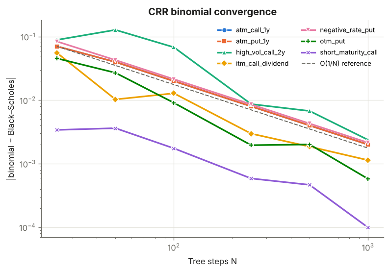
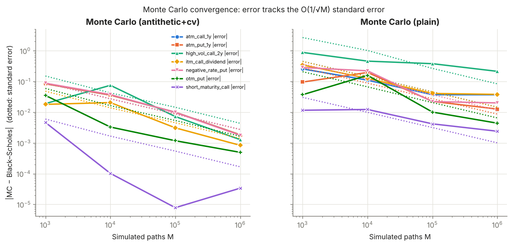
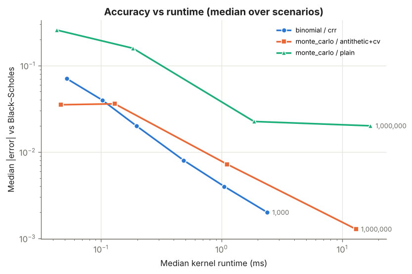
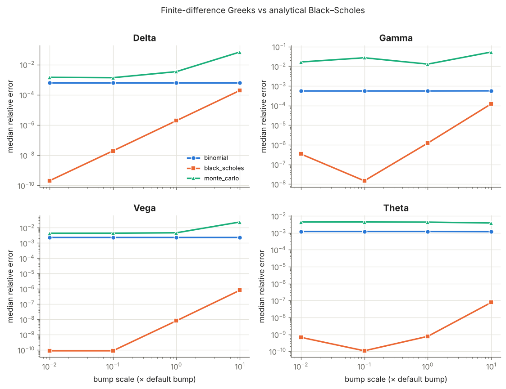

# Benchmark report

Generated 2026-10-28T22:06:22+00:00 · derivatives-engine 1.0.0 · backend `python`

## Environment

- Python 3.13.18 (CPython), NumPy 2.5.3, SciPy 1.18.1
- Linux-6.18.44-fc-v180-x86_64-with-glibc2.39 · x86_64 · 2 logical CPUs
- Thread env: {'OMP_NUM_THREADS': None, 'OPENBLAS_NUM_THREADS': '1', 'MKL_NUM_THREADS': None}
- Timing: 1 warm-up + 5 timed runs, median reported (ms). Kernel = pricing function only; end-to-end = `price_option` incl. validation and benchmark.

## Binomial convergence

```text
tree_steps  median_abs_error  max_abs_error  median_kernel_ms  median_e2e_ms
----------  ----------------  -------------  ----------------  -------------
        25          0.070382       0.088891          0.052154       0.066043
        50          0.039892       0.127772          0.102231       0.111553
       100          0.019972       0.068040          0.197265       0.204857
       250          0.007995       0.008678          0.484944       0.556406
       500          0.003998       0.006760          1.049375       1.030553
      1000          0.001999       0.002374          2.391403       2.343321
```

## Monte Carlo convergence

```text
variant        n_paths  median_abs_error  max_abs_error  median_std_error  max_|z|   median_kernel_ms  median_e2e_ms
-------------  -------  ----------------  -------------  ----------------  --------  ----------------  -------------
antithetic+cv     1000          0.035197       0.087532          0.089989  0.966333          0.046613       0.067386
antithetic+cv    10000          0.036058       0.074994          0.027278  1.760916          0.129947       0.221625
antithetic+cv   100000          0.007227       0.009963          0.008740  1.139869          1.108595       1.056991
antithetic+cv  1000000          0.001279       0.001835          0.002741  0.669427         13.017943      11.953179
        plain     1000          0.257050       0.881461          0.373224  0.769975          0.043133       0.069965
        plain    10000          0.158532       0.458768          0.118713  2.371299          0.183579       0.225708
        plain   100000          0.022522       0.378997          0.036927  1.425252          1.856821       1.594968
        plain  1000000          0.020073       0.213365          0.011666  2.625730         17.192286      17.182864
```

## Finite-difference Greeks at default bumps (relative error vs analytical)

```text
method         greek  median_rel_error  max_rel_error
-------------  -----  ----------------  -------------
black_scholes  delta         1.927e-06      1.747e-04
black_scholes  gamma         1.224e-06      6.619e-05
black_scholes   vega         8.114e-09      4.883e-08
black_scholes  theta         7.670e-10      8.472e-08
     binomial  delta         6.284e-04       0.003382
     binomial  gamma         5.549e-04       0.002333
     binomial   vega          0.002312       0.009129
     binomial  theta          0.001207       0.008546
  monte_carlo  delta          0.003393       0.063912
  monte_carlo  gamma          0.012895       0.066466
  monte_carlo   vega          0.004694       0.023267
  monte_carlo  theta          0.004282       0.020150
```

## Put–call parity

```text
scenario             method         residual    tolerance  passed
-------------------  -------------  ----------  ---------  ------
        atm_call_1y  black_scholes    0.000000  1.000e-07    True
        atm_call_1y       binomial   1.464e-12  1.000e-07    True
        atm_call_1y    monte_carlo   -0.059561   0.254761    True
         atm_put_1y  black_scholes    0.000000  1.000e-07    True
         atm_put_1y       binomial   1.464e-12  1.000e-07    True
         atm_put_1y    monte_carlo   -0.059561   0.254761    True
  itm_call_dividend  black_scholes  -1.421e-14  1.000e-07    True
  itm_call_dividend       binomial  -6.565e-12  1.000e-07    True
  itm_call_dividend    monte_carlo   -0.051307   0.222495    True
            otm_put  black_scholes    0.000000  1.000e-07    True
            otm_put       binomial   3.809e-12  1.000e-07    True
            otm_put    monte_carlo   -0.095953   0.386619    True
short_maturity_call  black_scholes    0.000000  1.020e-07    True
short_maturity_call       binomial   2.444e-12  1.020e-07    True
short_maturity_call    monte_carlo   -0.007407   0.035031    True
   high_vol_call_2y  black_scholes    0.000000  1.100e-07    True
   high_vol_call_2y       binomial  -2.430e-12  1.100e-07    True
   high_vol_call_2y    monte_carlo   -0.416352   1.270550    True
  negative_rate_put  black_scholes    0.000000  1.000e-07    True
  negative_rate_put       binomial   2.757e-12  1.000e-07    True
  negative_rate_put    monte_carlo   -0.063704   0.270525    True
```

## Plots






## Caveats

- Errors are measured against the Black–Scholes closed form under identical assumptions; they are not claims about executable market prices.
- Monte Carlo errors are single seeded draws; compare them with the reported standard error rather than reading them as deterministic accuracy.
- Runtimes depend on hardware, BLAS threading and system load; no native backend is included, so no acceleration factors are claimed.
